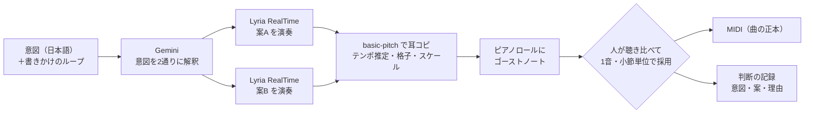

# Ghostnotes：Lyria を「提案役」にする DAW の検討と試作

- 更新：2026-11-06
- 作成：Yunative（Claude Code と一緒に作成。Gemini 3.1 Pro に審査員の立場で批評させ、その指摘を反映した）
- 状態：試作がブラウザで動く段階。チームでの採用はまだ決まっていない

## 結論

Lyria を使う案は、曲の正本を MIDI に置き、Lyria の演奏を耳コピして提案として重ねる形にすれば、ハッカソンの期間内に形にできる見込みがある。この形を試作したものが Ghostnotes である。意図を書くと、Gemini が意図を2通りに解釈し、Lyria がそれぞれを演奏する。耳コピした音はピアノロールに提案（ゴーストノート）として重なり、人が聴き比べて1音ずつ採用し、理由を記録する。ここまでがブラウザで一通り動いている。

議論で挙がった懸念のうち、「Lyria では一部だけを書き換えられない」は、この形では問題にならない。Lyria の音声を書き換えるのではなく、MIDI 上で採用する音を選ぶからである。「AI の耳コピは難しい」は、一般の楽曲については今も正しい。ただ、Lyria に単音の楽器だけを、テンポとキーを指定して弾かせると、耳コピの結果は偶然より元の演奏に近くなった。リード6本では、耳コピを鳴らし直した音の高さが、偶然に一致する場合の値を6本とも上回った。音の出だしの位置は、旋律10本すべてでランダムに置いた場合を上回ったが、差が小さいものもあった（4章）。どの音が正しく拾えているかを最後に判断するのは、利用者の耳である。

一方で、「生成した音声を MIDI にする」こと自体は新しくない。Suno Studio には生成した曲のパートから MIDI を取り出す機能があり、Logic Pro はコード進行に合わせてベースや鍵盤の MIDI を生成できる（3章）。Ghostnotes が既存の製品と違うのは、書きかけのループと言葉で書いた意図に合わせて提案が出ること、意図の解釈を2通り比べられること、1音単位で採用して理由を残せることである。発表では、この3点を主張の範囲にする。

チームで決めてほしいことは次の3つである。

1. このテーマ（Lyria の提案を人が選ぶ DAW）で進めるか。
2. 進める場合、Sirius さんの試作（編集レシピと保護条件）や PatchIntent 案と、どう組み合わせるか（6章）。
3. 公開に使う GCP プロジェクト。中継サーバーを Cloud Run に置き、API キーは Secret Manager に入れる（8章）。

## 1. 前提

ハッカソンは GDGoC Japan の Devfest 2026 Hackathon（Discord では DF Hack26）で、大会テーマは "Own the Why, Build with Intent." である。提出期限は 11/10 の 19:00。チームは Sirius、Compass、mysophob1a、Yunative の4人で、Sirius さんの GCP プロジェクト（無料トライアル枠の残り約320ドル）を使える。

大会から配られるクラウドのクレジットは1チーム20ドルで、有効にするにはクレジットカードの登録が要る。このクレジットは Google AI Studio（API キーで使う Gemini API）には使えず、AI Studio は無料枠で使うか、Google Cloud の Vertex AI 経由で使うよう案内されている（キックオフの配信のスライドによる）。Vertex AI は 2026年4月に「Gemini Enterprise Agent Platform」に改称されている。

審査基準と、Google の技術をどこまで使う必要があるかは確認できていない。キックオフ資料（Discord に共有された PDF）をまだ読んでいない。

## 2. これまでの議論で出た案と懸念

11/3 から 11/6 にかけて、Discord で次の案が出た。

| 案 | 出した人 | 中身 |
|---|---|---|
| PatchIntent | Sirius | 音の部品を線でつなぐブラウザのシンセ。「出だしを柔らかく」と頼むと、AI が2案と理由を示し、人が聴き比べて選ぶ |
| 曲とストーリーの対応付け | mysophob1a | 曲を区間ごとに物語の場面に対応させ、物語の言葉を書き換えると曲のその部分が変わる |
| 編集レシピ | Sirius | ドラムに絞ったビートメイク環境。AI は「どこを・どう変え・何を守るか」をレシピとして返し、プログラムが適用して守る部分が変わっていないかを検証する。試作あり |
| 音声 → テキスト → 音声 | mysophob1a | Gemini で音声を場面の説明に起こし、人が説明を直して音声を作り直す |
| 曲をコードに戻す | mysophob1a | Alda のような音楽プログラミング言語に曲を変換し、コードとして編集する |
| 作曲のオートコンプリート | mysophob1a、Yunative | コードエディタや DAW で、続きを補完する |

これらの案に対して、次の懸念が挙がった（Compass さんのまとめと、その前後の発言による）。

- ACE Studio、Suno Studio、Ableton の Extensions SDK などが既にあり、DAW と AI の連携だけでは差別化できない。
- Lyria の出力は音声なので、一部だけを書き換えられない。区間を切り貼りすると継ぎ目が不自然になり、全体を作り直すと一貫性がなくなる。
- 音声を MIDI に戻す耳コピは、人間でも詳しい人しかできず、AI でもまだ難しい（2026-10-28 の報道もこの見方）。
- Lyria の機能に包装を付けただけでは、新規性が出にくい。
- Gemini に音声を聴かせて説明させると、音量の変化程度は拾えても、コード進行などは誤ることがある。

## 3. Ghostnotes の仕組みと、懸念への答え

### 何をするアプリか

Ghostnotes は、ドラム・ベース・リードの3トラックだけを持つ小さな DAW である。リードかベースを選んで「ベースに寄り添う、少し切ないメロディ。最後の小節で上がって終わりたい」のように書くと、次の順に処理が進む。

1. Gemini が、意図と今のトラックの中身（MIDI を文字にしたもの）を読み、意図を2通りに解釈する。案ごとに、Lyria へのプロンプト、楽器、音数の多さ（density）、明るさ（brightness）と、その解釈がもう一方の案と比べて何を優先したかを返す。
2. Lyria RealTime が、曲と同じ BPM・キーで、2案を同時に約14秒ずつ演奏する。
3. Spotify の採譜モデル basic-pitch が、ブラウザの中で演奏を耳コピする。結果は、演奏の実際のテンポで16分音符の格子に合わせ、キーのスケールとパートの音域に合わせて単音に整える。
4. 整えた音を、ピアノロールに枠だけの音（ゴーストノート）として重ねる。Gemini は、そのフレーズの形と、既存のベースとの関係を説明する。
5. 人は、案A と案B を切り替え、自分のノートだけ、ゴーストを重ねた音、Lyria の原音を重ねた音の3通りで聴き比べる。気に入った音をクリックして1音ずつ採用するか、まとめて採用する。
6. 最後に、採用した理由を書いて閉じる。意図、比べた2案、どちらから何音採用したか、理由が記録に残る。

### 懸念への答え

一部だけを書き換えられない問題は、Ghostnotes では起きない。曲の正本は MIDI であり、Lyria の音声は提案を作る材料としてだけ使うからである。採用した音だけが MIDI に入るので、採用しなかった部分は1音も変わらない。Sirius さんの編集レシピ案が守ろうとしていた「触ってほしくない部分を変えない」も、この仕組みで満たせる。

耳コピの難しさは、対象を絞ることで下げている。一般の楽曲の耳コピが難しいのは、楽器が重なり、テンポとキーも分からないからである。Ghostnotes では Lyria に、単音の楽器だけを、指定したテンポとキーで弾かせる。答えの範囲を狭めたうえで耳コピするので、精度が上がる（4章）。それでも誤検出は残るので、確からしい音を実線、誤検出の可能性がある音を点線で描き分け、最終的には人が耳で判断する。

Lyria のラッパーに過ぎないという指摘には、Lyria にできないことを足している点で答えられる。Lyria は音声を出すだけで、その中のどの音を使うかを人が選ぶ手段はない。

### 既存の製品との違い

調べた範囲では、近い機能を持つ製品が2つある。

- Suno Studio は、生成した曲をパート（ステム）に分け、パートごとに「Get MIDI」で MIDI を取り出せる。公式ヘルプによれば1回10クレジットかかる（[Suno ヘルプ](https://help.suno.com/en/articles/13925249)）。
- Logic Pro の Session Players は、ドラム、ベース、鍵盤、シンセの演奏をコード進行に合わせて生成し、生成後に編集できる（[MusicRadar](https://www.musicradar.com/music-tech/apple-expands-logic-pros-ai-features-with-a-synth-player-and-a-personal-music-theory-expert-that-can-generate-chord-progressions-from-any-audio-or-midi-recording-that-you-play-it)、[Sound On Sound](https://www.soundonsound.com/techniques/logic-pro-synth-players?amp)）。

ACE Studio は、利用者が書いた MIDI から歌声や楽器の演奏を作る製品で、旋律そのものを生成する機能は確認できなかった（[ACE Studio](https://acestudio.ai/ai-instruments/)、[MusicTech のレビュー](https://musictech.com/reviews/digital-audio-workstations/ace-studio-2-review/)）。

したがって、「AI が作った音声を MIDI にする」ことと「DAW の中で AI が MIDI を生成する」ことは、どちらも既にある。Ghostnotes が違うのは次の3点である。

- 提案が、書きかけのループの中身と、言葉で書いた意図に合わせて作られる。Suno は曲全体を生成してから分け、Logic はコード進行と演奏スタイルのパラメーターから生成する。
- 1つの意図を2通りに解釈した案を並べ、それぞれが何を優先したかを示す。
- 採用を1音単位で行い、何を頼み、どちらの案から何を採り、なぜ採ったかを記録する。

ただし、これらの製品を実際に操作しての確認はしていない。上の比較は、公式ヘルプと報道・レビュー記事にもとづく。

## 4. 検証結果

### 単発の検証

最初に、Lyria RealTime の出力をファイルに保存し、basic-pitch で耳コピして基本的な性質を確かめた。

| 確かめたこと | 結果 |
|---|---|
| 応答の速さ | 最初の音が届くまで約3〜5秒。その後は実時間と同じ速さで届く（20秒分に約21秒） |
| キーの指定 | 耳コピした音のうち、指定したスケールの音の割合は、旋律 13本で 92〜100% |
| ピアノ | 20秒で262音を拾い、同時に最大8音が鳴っていた。和音と残響が多く、メロディとしては使えなかった |
| シンセのリード | 整形後、2小節離れた位置に同じ音がある箇所が27か所中19か所あった。Lyria が2小節のフレーズを繰り返し、耳コピも毎回ほぼ同じ音を拾えていたことになる |

楽器の選び方で結果が大きく変わった。Gemini に楽器を自由に選ばせたところギターを選び、低い弦の音まで拾ってしまった。そこで、リードはフルート、クラリネット、オカリナ、マリンバ、矩形波シンセなど、ベースはシンセベース、エレキベース、ウッドベースの単音楽器から選ばせるようにした。

### 耳コピがどれだけ元の演奏と合っているか

画面上の音の並びを見ただけでは、耳コピが正しいかは分からない。そこで、耳コピして整えた MIDI を単純な音で鳴らし直し、元の Lyria の音声の同じ4小節と比べた。比べたのは2つの量である。

- 音の高さの一致（クロマ類似度）：12の音名ごとの成分を短い区間ごとに比べ、両方が鳴っている区間で平均した値。1 に近いほど同じ音名が鳴っている。
- 音の出だしの一致：音の出だしの強さの時間変化どうしの相関。

一致度が偶然でも出る値を知るため、鳴らし直した音を1拍ずらしたものと、音名をランダムに入れ替えたものでも同じ値を計算し、基準値とした。楽器、キー、BPM を変えて旋律を10本生成した結果が次の表である（1本ずつの数値は `docs/data/eval-2026-11-06.jsonl`）。

| パート | 本数 | 音の高さの一致 | 基準値（1拍ずらし） | 基準値（音名ランダム） | 音の出だしの相関 |
|---|---|---|---|---|---|
| リード | 6 | 0.65〜0.90 | 0.53〜0.62 | 0.29〜0.41 | 0.04〜0.59 |
| ベース | 4 | 0.93〜0.97 | 0.65〜0.97 | 0.40〜0.57 | 0.10〜0.57 |

リードは6本とも、音の高さの一致が2つの基準値を上回った。1拍ずらしとの差は、オカリナが最も大きく（0.90 対 0.62）、フルートの1本とクラリネットが最も小さかった（それぞれ +0.07）。音の出だしの相関は5本で 0.42〜0.59 だったが、クラリネットだけは 0.04 で、出だしの位置はほとんど合っていなかった。

ベースは、この指標では良し悪しを判定できなかった。同じ音を繰り返すベースラインでは、1拍ずらしても同じ音名が並ぶため、基準値も高くなる（エレキベースの1本は 0.97 対 0.97）。

そこで、音の出だしを音符単位で照合する指標も計算した。元の音声から検出した音の出だしと、耳コピした各音の開始時刻を ±50ms の範囲で対応付け、F 値（見つけた音のうち正しかった割合と、元の音のうち見つけた割合の調和平均）を求める。基準値は、同じ数の音を16分音符の格子上にランダムに置いた場合の F 値である。

| パート | 本数 | 出だしの F 値 | 基準値（ランダム配置） | 差 |
|---|---|---|---|---|
| リード | 6 | 0.38〜0.77 | 0.34〜0.68 | +0.03〜+0.16 |
| ベース | 4 | 0.58〜0.76 | 0.38〜0.73 | +0.03〜+0.30 |

10本すべてが基準値を上回ったが、差が 0.05 未満のものが3本あった（矩形波シンセ、クラリネット、シンセベース）。音数が多いフレーズでは、ランダムに置いても当たりやすく、差が出にくい。クラリネットは、元の音声から検出した出だしが21個なのに対して耳コピは53音で、1つの音を細切れに拾っていた。この結果を受けて、クラリネットは楽器の候補から外した。

この評価は、耳で聴いて良し悪しを判断したものではない。音の高さと出だしが元の演奏とどれだけ合っているかを測っただけで、フレーズとして自然かどうかは測っていない。

### テンポの指定がどれだけ守られるか

ドラムだけを 80、100、120、140 BPM で生成し、拍の間隔を推定した。4本とも、拍の間隔の中央値は指定値から 0.2〜2.5% の範囲に入り、拍ごとのばらつきは 13〜23ms だった。ただし、最初に作った 100 BPM 指定の4つ打ちは、拍の間隔のばらつきが 56ms と大きく、推定値も 80〜87 BPM と定まらなかった。5本中1本はテンポが安定しなかったことになる。

旋律でも、10本中3本は指定より 1.2〜3% 速く演奏していた。指定したテンポのまま格子に合わせると、4小節の間に出だしが少しずつずれる。そこで、演奏の実際のテンポを指定値の前後 8% の範囲から推定し、そのテンポで格子に合わせるようにした。矩形波シンセの例（推定 121.2 BPM、指定 120 BPM）では、音の出だしの相関が −0.004 から 0.587 に上がった。Lyria の原音を重ねて聴くときは、再生速度を曲のテンポに合わせて揃えている。

### 非リアルタイムのモデル（Lyria 3.5 と 3 Clip）

音質では、時間をかけて曲を作る Lyria 3.5 のほうが RealTime より有利なはずである。ただし 3.5 と 3 Clip は、BPM とキーを設定値で渡せず、プロンプトの文章で伝えるしかない。そこで、3つの楽器・キー・BPM について、3.5（時刻つきのプロンプトと、なしのプロンプト）と 3 Clip を1本ずつ生成し、指示がどれだけ守られるかを測った（9本。1本ずつの数値は `docs/data/eval-l35-2026-11-06.jsonl`）。

| モデル | 返った長さ | 生成の待ち時間 | 推定テンポのずれ | 指定キーの音の割合 |
|---|---|---|---|---|
| Lyria 3.5（6本） | 58〜65秒（約20秒と指示） | 10〜21秒 | −2〜+3% | 61〜100% |
| Lyria 3 Clip（3本） | 29〜31秒 | 11〜19秒 | −2〜+52% | 78〜97% |

3.5 は、プロンプトの書き方に関係なく1分前後の曲を返した。テンポは数%のずれに収まったが、キーは守らないことがあった。時刻つきのプロンプトで作ったベースの1本は、同時に最大7音が鳴っていて、「ほかの楽器なし」の指示も守らなかった可能性がある。3 Clip は長さを守る一方、100 BPM の指定に対して推定 152 BPM の例があった。

そこで、非リアルタイムのモデルを使うときは、耳コピのあとで演奏を曲に合わせる処理（`conform`）を入れた。

- テンポ：前後 15% の範囲から実際のテンポを推定し、そのテンポで格子に合わせる。
- キー：−6〜+5 半音の移調のうち、曲のスケールに入る音の割合が一番高いものを選ぶ。差が小さければ移調しない。最初はキーを推定してから移調量を決めていたが、G と D のように音が6つ共通するキーを取り違え、正しいキーで弾かれたベースまで移調していたので、この方法に変えた。
- 長さ：長い出力の中から、音が格子に一番よく乗る4小節を選ぶ。

この処理を通した9本では、耳コピを元の高さで鳴らし直した音の高さの一致が 0.71〜0.92 で、9本とも1拍ずらしの基準値（0.39〜0.78）を上回った。音の出だしの照合の F 値（0.36〜0.94）も、9本ともランダム配置（0.21〜0.50）を上回った（`docs/data/eval-l35-conform-2026-11-06.jsonl`）。どの案を既定にするかは、耳で聴いて決める必要がある。画面では Lyria 3.5 を既定にし、3 Clip と RealTime も選べるようにした。

### 1回の提案にかかる時間

ブラウザで意図の入力から2案の表示まで、RealTime では約49秒かかった。内訳は、Gemini が約5秒、Lyria の演奏が約17秒（2案は同時に生成）、2案の耳コピが約28秒である。Lyria 3.5 では 88〜131秒かかった。作曲は約20秒だが、返ってくる曲が長く、耳コピに時間がかかる（先頭の35秒だけを耳コピしている）。どちらも GPU のない環境で測った値で、耳コピのモデルはページを開いた直後に読み込むようにしている。GPU のある普通の PC での時間は測っていない。

## 5. 試作の現状

リポジトリは `ghostnotes`（ローカルのみ、未公開）。

| 部分 | 使っているもの |
|---|---|
| 画面と再生 | TypeScript、Vite、Tone.js |
| 意図の解釈と説明 | Gemini API（gemini-flash-latest、構造化出力）。Vertex 経由のときは gemini-2.5-flash |
| 演奏の生成 | Lyria 3.5（既定）、Lyria 3 Clip、Lyria RealTime から選ぶ。Vertex 経由では Lyria 3 Pro と 3 Clip |
| 耳コピ | basic-pitch（ブラウザの Web Worker で実行） |
| 公開用の中継サーバー | Node.js（Gemini と Lyria の通信を中継する。AI Studio のキーか、Vertex の認証はサーバーだけが持つ） |

試作でできることは次のとおり。

- 意図を2通りに解釈した2案の同時生成と、案の切り替え（キー 1／2）
- 1音ずつの採用、小節ごとの採用、全部の採用。確からしい音を実線、誤検出の可能性がある音を点線で描き分ける
- 演奏の実際のテンポの推定と、それに合わせた格子合わせ
- 採用した音の MIDI ファイルへの書き出し（手元の DAW で続きを作れる）
- Lyria のモデルの選択（3.5、3 Clip、RealTime）。非リアルタイムのモデルでは、演奏のテンポとキーを曲に合わせ、Lyria の原音を重ねて聴くときもピッチシフトで曲のキーに揃える
- DAW としての基本操作：ノートのドラッグでの移動と長さ変更、元に戻す・やり直す、トラックごとの音色・音量・ソロ・ミュート、WAV 書き出し
- ドラムの提案（試験的）。Lyria にドラムだけを叩かせ、低音・中音・高音の帯域ごとの音の立ち上がりから、キック・スネア・ハイハットの位置を拾う
- 実演用のデモモード。事前に生成した2案を、生成を待たずに出す（事前生成であることは画面と記録に明示する）
- 公開用の中継サーバー。AI Studio のキーと Vertex AI（Agent Platform）のどちらでも動く。Vertex 側は GCP の認証情報がなく、まだ試せていない

Playwright で、意図の入力から、2案の生成、案の切り替え、採用、記録までを通しで確かめている。中継サーバーを通した場合と、デモモードと MIDI 書き出しも、同じように確かめている。DAW の操作（ノートの追加、移動、長さ変更、元に戻す、音色、音量、ソロ、WAV 書き出し）も Playwright で確かめている。整形処理、MIDI 書き出し、ドラム検出には単体テストがある。MIDI 書き出し、ドラム検出、ピアノロールのドラッグ操作は、z.ai の GLM-5.3 に別の作業ツリーで書かせ、レビューして取り込んだ。

ドラムの提案は、まだ精度が足りない。合成したドラム音では3つの楽器とも取りこぼしも誤検出もなかったが、Lyria が叩いたドラム4本では、librosa で帯域ごとに検出した出だしとの一致（F 値）が、キック 0.71〜0.80、スネア 0.59〜0.67、ハイハット 0.89〜1.00 だった。どちらの検出も完璧ではないので、この値は目安である。また、Gemini がプロンプトにベースを含めると、低音域にベースが混ざり、キックをほぼ全ステップで拾ってしまった。プロンプトにベースを書かせないようにし、キックとスネアは強い順に4小節で32音までに絞っている。

## 6. 他の案とどう組み合わせるか

PatchIntent 案の「2案を比べて選ぶ」は、既に取り込んだ。PatchIntent の対象は音色（シンセの部品と設定）で、Ghostnotes の対象はフレーズ（音符）なので、両方を1つの画面に並べることもできる。

Sirius さんの編集レシピ案とは、レシピの「何を守るか」を共有できる。Ghostnotes では既存のノートを AI が書き換えないので、保護条件は最初から満たされている。逆に、うまくいった指示（意図、楽器、density など）をレシピとして保存し、別の曲で使い回す部分は、編集レシピ案から取り込める。

mysophob1a さんの「作曲のオートコンプリート」は、Ghostnotes の操作に近い。ゴーストノートを Tab で採用する操作は、コード補完と同じ感覚で使える。

## 7. デモの筋書き（3分の想定）

1. ドラムとベースだけの4小節を流す。「ここにメロディを足したいが、どう作ればいいか分からない」という初心者の場面を示す。
2. 「ベースに寄り添う、少し切ないメロディ。最後の小節で上がって終わりたい」と入力する。Gemini が意図を2通りに解釈し、それぞれ何を優先したかを示す。
3. Lyria の演奏が流れ、ピアノロールにゴーストノートが現れる（待ち時間は動画では早送りする）。
4. 案A と案B を聴き比べる。利用者は自分の耳で、たとえば「案B の前半のリズムは好きだが、最後が下がって終わるのは意図と違う」と判断し、前半だけを採用して最後の数音は自分で上がる音に打ち直す。Gemini の説明は、なぜそう感じたかを言葉にする手がかりとして横に表示しておく。
5. 採用した理由を書いて閉じる。記録には、何を頼み、どちらの案から何を選び、なぜ選んだかが残る。

最後の判断を AI の説明ではなく利用者の耳に置くのは、大会テーマが「AI に丸投げせず、人が理由を持つ」ことだからである。AI の説明に従って音を消す流れにすると、判断の主体が AI に移って見える。

## 8. 11/10 までの計画

| 日 | 作業 |
|---|---|
| 11/6 | ドラムの提案（試験的）、Lyria 3.5 への対応、DAW の基本操作、Vertex 経由の作曲を追加した |
| 11/7 | ハッカソンのクレジットを有効にしたプロジェクトで Vertex 経由の作曲を試し、Cloud Run で公開する（手順は `docs/公開手順.md`）。チームで操作を試し、デモの流れを決める |
| 11/8 | 初心者数人に試してもらい、採用率と操作で迷った点を記録する。生成した音を耳で聴いて評価する |
| 11/9 | 試用の結果を反映し、不具合を直す |
| 11/10 | デモ動画と説明資料を作り、19:00 までに提出 |

API キーは、公開版ではブラウザに置かない。Lyria RealTime は、Gemini の Live API 用の短時間トークン（ephemeral token）を受け付けなかった（SDK 経由でも、WebSocket を直接つないでも拒否された）。そこで、Cloud Run に置いた中継サーバーが API キーを持ち、ブラウザからの Gemini と Lyria の通信を中継する。中継サーバーは、使えるモデルを限定し、IP ごとの回数制限と、Lyria の1回の接続を60秒までに制限する。この構成はローカルでは通しで動いている。コンテナのビルドは、作業環境で Docker と podman が権限の問題で動かなかったため試せていない。ただし、`gcloud run deploy --source` を使えばビルドは Google 側の Cloud Build で行われるので、手元に Docker は要らない。Dockerfile と同じ手順（依存の導入、ビルド、本番用の依存での起動）は手元で再現し、画面とモデルが配信されることを確かめた。

実演では、生成に約50秒かかる。その間が間延びしないよう、生成中の音をそのまま流す。生成に失敗したときは、デモモードに切り替えて事前生成の2案を出す。

## 9. 外部レビュー（Gemini 3.1 Pro）

ドキュメントを Gemini 3.1 Pro に2回読ませ、ハッカソンの審査員と、懐疑的なチームメイトの2つの立場で批評させた。初版への指摘と対応は次のとおり。

| 指摘 | 対応 |
|---|---|
| デモで Gemini の説明に従って音を消す流れは、「人が理由を持つ」というテーマに反して見える | 利用者が耳で判断する流れに変えた（7章） |
| キックオフ資料を読んでおらず、必須の技術要件を満たしていない恐れがある | 公式サイトに情報がないことを確かめた。資料の確認はチームに依頼する（1章、10章） |
| 画面上の音の並びを見ただけで「意図どおり」と評価するのは飛躍がある | 耳コピを鳴らし直して元の演奏と比べる指標を作り、10本で測った。耳での評価は 11/8 に行う（4章） |
| 100 BPM のテンポ判定の失敗を、推定ツールのせいにしている | テンポを変えて生成し直した。5本中1本は Lyria 側のテンポが安定しなかったと結論を改めた（4章） |
| Lyria が短時間トークンに対応しているか確かめずに計画している | 確かめた結果、非対応だったので、中継サーバーの構成に変えて実装した（8章） |
| 既存の DAW との違いを根拠なく主張している | Suno Studio と Logic Pro に近い機能があることを確かめ、主張の範囲を絞った（3章） |
| 2案の同時生成で待ち時間が増え、デモが3分に収まらない | 2案は同時に生成し、耳コピのモデルを先に読み込むことで、1案だけのとき（約50秒）とほぼ同じ約49秒に収めた。動画では待ち時間を早送りする |

2回目（反映後の版）への指摘と対応は次のとおり。

| 指摘 | 対応 |
|---|---|
| 「偶然よりはっきり一致」は、クラリネットやベースの結果を考えると言い過ぎ | 音符単位の出だしの照合を加えて10本を測り直し、主張をリード6本と、出だしの照合の範囲に狭めた。クラリネットは楽器の候補から外した（4章） |
| Docker が動かないのに Cloud Run への配置を予定している | Cloud Build でビルドする手順にし、手元に Docker が要らないようにした（`docs/公開手順.md`） |
| 審査員の前での実演で、49秒の待ちが間延びするか失敗する | 生成中の音を流し、失敗時は事前生成の2案を出すデモモードを作った（5章、8章） |
| 初心者に1音ずつの採用は難しい | 小節ごとにまとめて採用するボタンを付けた。操作が実際に分かりやすいかは 11/8 の試用で確かめる |
| 既存製品を実際に操作して比べていない | 未対応。Suno Studio の MIDI 取り出しは有料プランの機能で、試せていない（10章） |
| キックオフ資料を読んでいない | 未対応。チームで確認する（10章） |

## 10. 未確認のこと

- 審査基準と、Google の技術を使う条件（キックオフ資料が未読）。
- 生成した音を耳で聴いた良し悪し。4章の評価は、音の高さと出だしの一致を測ったもので、フレーズとして自然かどうかは測っていない。
- Suno Studio、Logic Pro、ACE Studio を実際に操作しての比較。
- GPU のある普通の PC やスマートフォンで、1回の提案に何秒かかるか。
- Lyria RealTime の利用料金と、無料枠で何回試せるか。
- Cloud Run への配置と、Vertex AI（Agent Platform）経由の作曲（どちらもコードと手順は書いたが、GCP の認証情報がなく試していない）。Vertex の資料には Lyria 3.5 も RealTime も載っておらず、Vertex だけで公開すると 3.5 の代わりに 3 Pro になり、RealTime とドラムの提案は使えない。
- Lyria の利用料金。
- 初心者が実際に操作できるか（11/8 に試用する）。
